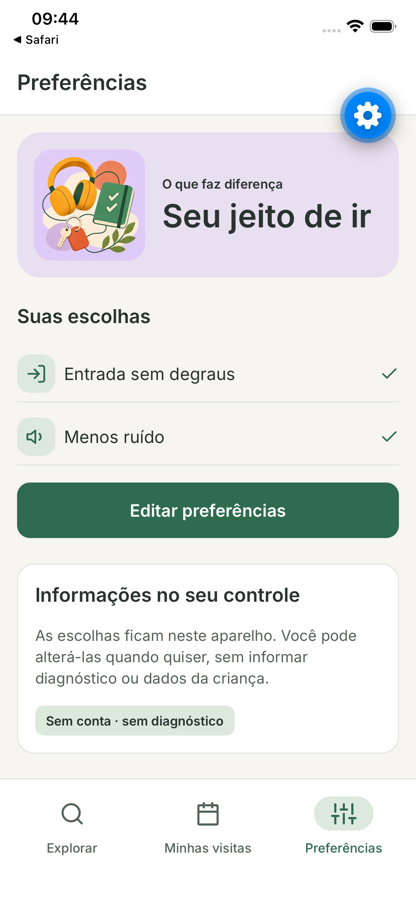
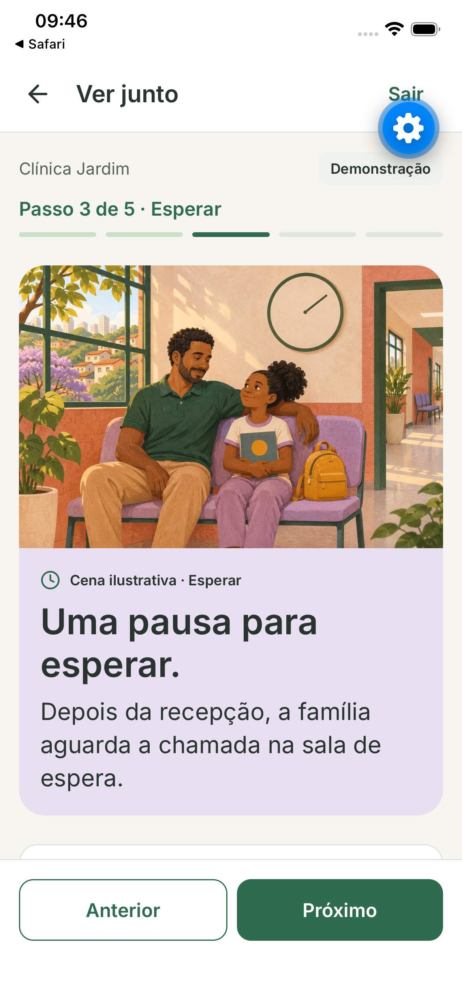
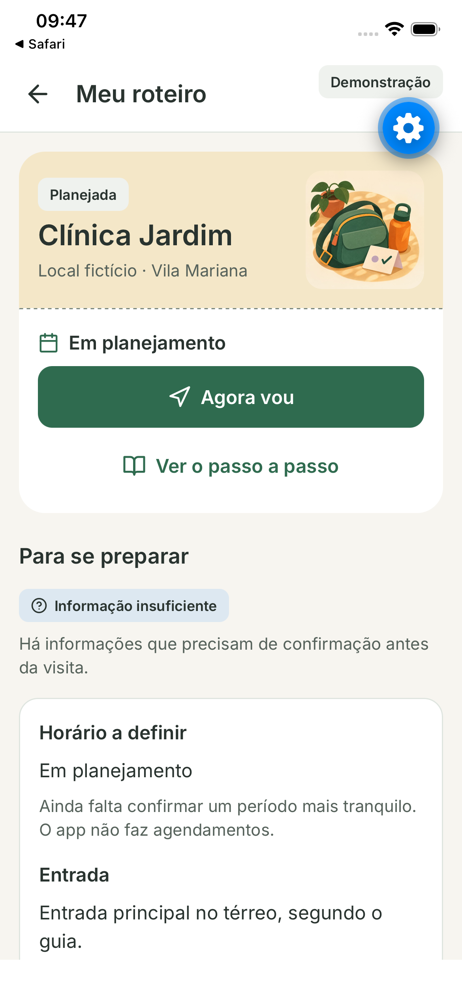
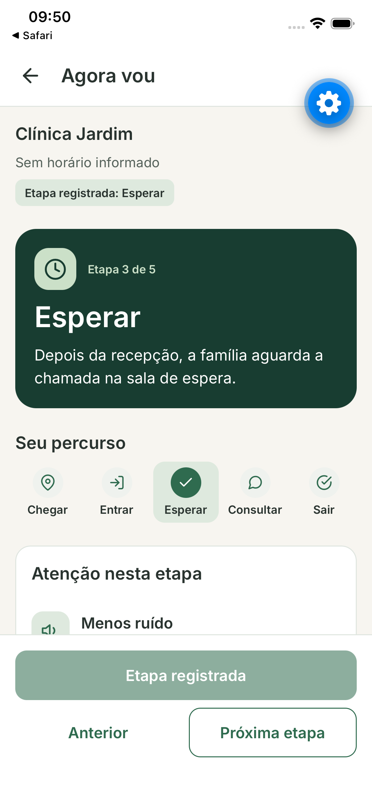
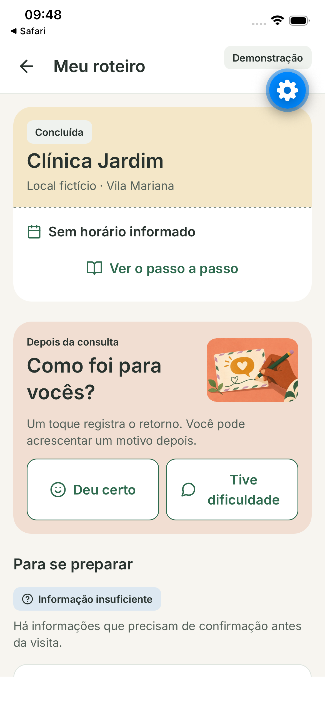

# Dá Pra Ir?

**Antes de sair, conheça o caminho.**

MVP mobile em português para ajudar PCDs, pessoas autistas e famílias a preparar a ida de uma criança às consultas. O recorte é **Vila Mariana, São Paulo**, com oito locais fictícios e colaboração simulada no próprio aparelho.

## Ficha da CitizenTech

| Item                    | Descrição                                                                                                                           |
| ----------------------- | ----------------------------------------------------------------------------------------------------------------------------------- |
| Projeto                 | Dá Pra Ir?                                                                                                                          |
| Problema                | Informações dispersas ou ausentes sobre chegada, espera, acessibilidade e etapas de uma consulta dificultam a preparação da família |
| Público                 | PCDs, pessoas autistas, familiares e acompanhantes de crianças                                                                      |
| Solução                 | Conhecer os passos da visita, organizar um roteiro pessoal e acompanhá-lo no celular                                                |
| Recorte                 | Um bairro de São Paulo, oito locais fictícios e a jornada de consultas com uma criança                                              |
| Colaboração             | Relatos e avisos anônimos, simulados localmente                                                                                     |
| Integrantes e RMs       | [Equipe](#equipe)                                                                                                                  |
| Repositório GitHub      | [BrnBastos/GS_DaPraIr_Mobile](https://github.com/BrnBastos/GS_DaPraIr_Mobile)                                                          |
| Vídeo da demonstração   | [Assistir no YouTube (1min35s)](https://youtu.be/YiLNqD0ylUU) · [Baixar o MP4](https://github.com/BrnBastos/GS_DaPraIr_Mobile/releases/download/v0.2.0/Da-Pra-Ir-com-narracao.mp4) |

### Equipe

| Integrante      | RM     |
| --------------- | ------ |
| Carlos Henrique | 558003 |
| Mauricio Alves  | 556214 |
| Ian Monteiro    | 558652 |
| Bruno Silva     | 550416 |
| João Hoffmann   | 550763 |

## O que está implementado

- Explorar com busca sem distinção de acentos, filtros e fotos locais.
- Preferências por mobilidade, ambiente e comunicação, sem pedir diagnóstico.
- Ficha com **Como é / Como foi / Como está**, validade e histórico.
- Pré-visita com cinco cenas ilustradas, navegação por botões, retomada da leitura e modo **Ver junto**.
- Visita salva, data e horário opcionais e preferências copiadas para o roteiro.
- Perguntas derivadas de informações ausentes ou vencidas e checklist pessoal editável.
- **Agora vou** com registro manual de etapa, retomada e encerramento explícito.
- Retorno após a visita em um toque, motivo opcional e registro de avisos.
- Confirmação e resolução de avisos com eventos datados, preservando o histórico.
- Migrações SQLite, carga inicial única e persistência de todos esses registros.
- Identidade editorial com ilustrações próprias, composições adaptadas a cada tarefa e abas estáveis.

A direção segue o [plano original](docs/PLANO_DA_PRA_IR.md) e o [update de produto e design](docs/UPDATE_PLANO_DA_PRA_IR.md). O histórico da estrutura inicial está em [ETAPA_1.md](docs/ETAPA_1.md).

## Stack e versões

| Tecnologia               | Versão                                                                  |
| ------------------------ | ----------------------------------------------------------------------- |
| Node.js                  | 24 LTS; execução validada com 24.20.0                                   |
| Expo SDK                 | 57 (`~57.0.33`)                                                         |
| Expo Go do simulador iOS | 57.0.9                                                                  |
| Expo Router              | `~57.0.31`                                                              |
| React / React Native     | 19.2.3 / 0.86.3                                                         |
| TypeScript               | `~6.0.3`, modo estrito                                                  |
| Persistência             | `expo-sqlite ~57.0.5`                                                   |
| Tipografia               | `expo-font`, Inter Regular, Medium e SemiBold locais                    |
| Data e horário           | `@react-native-community/datetimepicker`, compatível com este SDK       |
| Testes                   | Runner do Node 24 e SQLite real, com o mesmo repositório usado pelo app |

O Expo Go precisa suportar **SDK 57**. A escolha foi feita para compatibilidade com Expo Go físico durante a transição do SDK, conforme a [documentação oficial](https://docs.expo.dev/get-started/create-a-project/). Não atualizar o SDK isoladamente sem conferir o cliente do aparelho.

## Executar

Clone o repositório e rode na pasta do aplicativo:

```bash
git clone https://github.com/BrnBastos/GS_DaPraIr_Mobile.git
cd GS_DaPraIr_Mobile
nvm use
npm ci
npm start
```

Se você já tem o código, execute os comandos a partir de `nvm use` na pasta que contém `package.json`. Sem `nvm`, use Node 24 LTS. `.nvmrc`, `engines` e `.npmrc` registram o requisito; `package-lock.json` fixa as dependências.

Conecte computador e celular à mesma rede e leia o QR code com a Câmera do iPhone ou pelo Expo Go no Android. Se a rede impedir a conexão, use `npm start -- --tunnel` e siga a orientação da CLI. Não é necessário cadastro para usar o MVP.

```bash
npm run ios        # simulador iOS disponível, com Xcode
npm run android    # emulador Android disponível
npm run web        # prévia no navegador com SQLite Web
npm run test       # regras, migrações e persistência com SQLite real
npm run typecheck  # TypeScript
npm run lint       # ESLint
npx expo-doctor    # compatibilidade do projeto
```

No navegador, `metro.config.js` habilita WASM e os cabeçalhos COOP/COEP necessários ao SQLite Web. Essa implementação do Expo SQLite é experimental; a plataforma principal do projeto é mobile. Uma eventual hospedagem web precisaria manter esses cabeçalhos. As fontes e imagens do app são locais.

## Uma jornada para conhecer

1. Em Preferências, escolha entrada sem degraus e menos ruído e salve.
2. Abra a Clínica Jardim e veja por que a avaliação é **Informação insuficiente**.
3. Percorra os cinco passos e experimente **Ver junto**.
4. Prepare e salve uma visita; marque e edite preparativos.
5. Feche e abra novamente o app e confira a persistência.
6. Em **Agora vou**, registre manualmente uma etapa, retome e finalize a visita.
7. Toque em **Deu certo** ou **Tive dificuldade** e acrescente um motivo se desejar.
8. Na ficha do local, registre um aviso de hoje, confirme sua continuidade e registre a resolução.

Para comparar: Casa Serena tem informações favoráveis nas características iniciais; Instituto Horizonte tem uma barreira de acesso; Espaço Ponte tem guia desatualizado. As condições mostradas dependem também de avisos válidos e das preferências escolhidas.

## Telas do app

Capturas da interface ilustrada da versão 0.2.0 rodando no Expo Go, no simulador iPhone 17e, com dados de demonstração. Clique em uma imagem para abrir a captura em tamanho original. Veja também a [ficha do local](docs/screenshots/interface/03-ficha-local.png).

| Explorar | Preferências | Pré-visita: Ver junto |
| :---: | :---: | :---: |
| <a href="docs/screenshots/interface/01-explorar.png"></a> | <a href="docs/screenshots/interface/02-preferencias.png"></a> | <a href="docs/screenshots/interface/04-ver-junto.png"></a> |

| Meu roteiro | Agora vou | Retorno após a visita |
| :---: | :---: | :---: |
| <a href="docs/screenshots/interface/05-meu-roteiro.png"></a> | <a href="docs/screenshots/interface/06-agora-vou.png"></a> | <a href="docs/screenshots/interface/07-retorno.png"></a> |

## Compatibilidade e validade

A avaliação é determinística e considera as necessidades selecionadas:

1. **Há barreiras** quando uma informação válida contraria uma escolha.
2. **Informação insuficiente** quando faltam informações válidas ou preferências.
3. **Compatível com suas preferências** quando todas as escolhas têm informação válida favorável.

Barreiras e lacunas podem aparecer juntas. Compatibilidade se refere às preferências avaliadas e às informações disponíveis.

Avisos duram **24 horas**; guias e relatos, **90 dias** desde a última confirmação. Os dados iniciais são relativos à primeira carga bem-sucedida. Um aviso vencido permanece no histórico e não é considerado resolvido; uma barreira posterior ainda sem resolução impede usar informação favorável mais antiga como confirmação suficiente. Guias vencidos não sustentam recomendações.

O checklist é pessoal: marcá-lo não confirma uma condição pública. Um retorno positivo geral também não confirma recursos de acessibilidade. Ler todos os passos do guia não encerra uma visita. Preferências novas só são aplicadas a uma visita existente quando a pessoa escolhe atualizá-la.

## Organização

```text
src/
  app/          Rotas e layouts do Expo Router
  components/   Navegação, cabeçalho, campos, botões e seleções
  features/     Explorar, preferências, locais, guia, visitas e contribuições
  domain/       Modelos, validade, compatibilidade, busca e datas
  services/     Mock assíncrono, inicialização e comandos de aplicação
  db/           Migrações e repositório SQLite transacional
  theme/        Cores, medidas e tipografia
assets/places/  Oito fotografias ilustrativas, com créditos
assets/illustrations/  Nove artes da interface e do guia
tests/          Testes das regras e jornada com SQLite real
```

O SQLite guarda locais, características, preferências, visitas, preparativos, relatos, avisos, eventos e posição de leitura. As consultas são assíncronas e parametrizadas, com índices e gravações transacionais. O marcador de carga inicial só é registrado quando toda a transação termina. Abrir novamente não sobrescreve contribuições.

## Dados simulados e limitações

Os oito estabelecimentos, endereços, guias e relatos iniciais são fictícios. As [fotografias de acervo](assets/places/CREDITS.md) e as [ilustrações da interface](assets/illustrations/README.md) não representam os locais nem comprovam características de acessibilidade. As regras de compatibilidade usam as informações registradas, independentemente das imagens.

As contribuições ficam neste aparelho. Não há sincronização entre famílias, publicação externa, agendamento real, rotas de deslocamento, detecção de presença ou orientação clínica. A etapa atual é registrada pela própria pessoa.

As verificações incluem a jornada no simulador iOS, a fonte máxima do sistema e a persistência com SQLite real. A validação completa em aparelho físico e com leitores de tela ainda está pendente. Confira a cobertura e os alertas transitivos de dependências em [VALIDACAO.md](docs/VALIDACAO.md).

## Entrega acadêmica

O vídeo narrado mostra uma família consultando um local, preparando a visita, acompanhando sua etapa e registrando como foi. Consulte o [roteiro do vídeo](docs/ROTEIRO_VIDEO.md) e a [conferência do enunciado](docs/CONFERENCIA_REQUISITOS.md).

Prazo do enunciado registrado no plano: **19/11, às 23h55**, horário de São Paulo. O envio do link do GitHub no Teams fica a cargo de um integrante.
